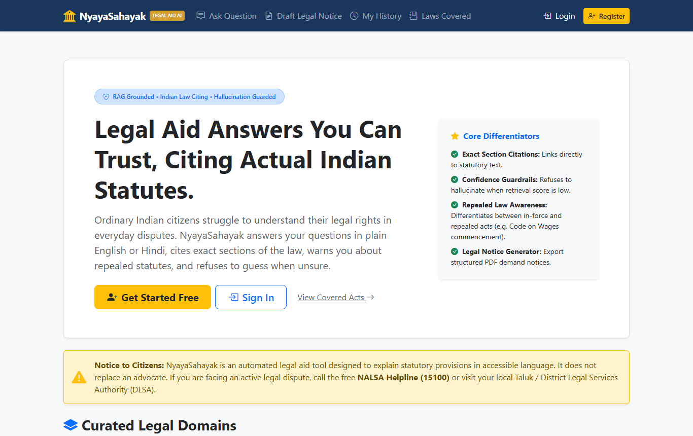
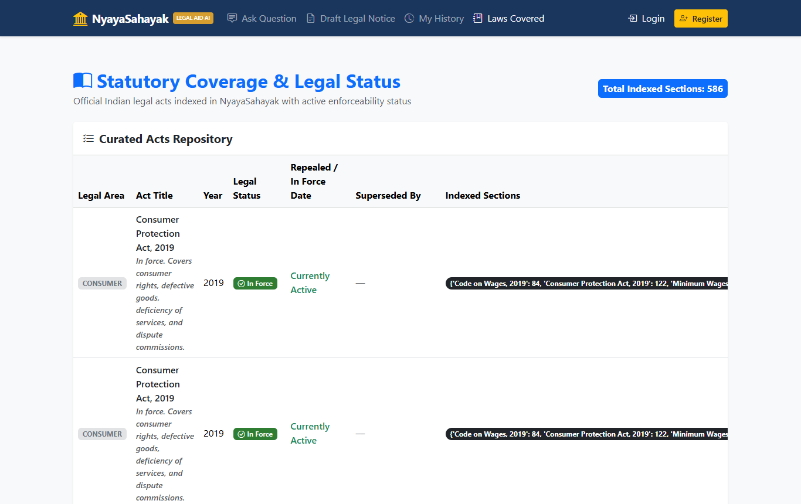
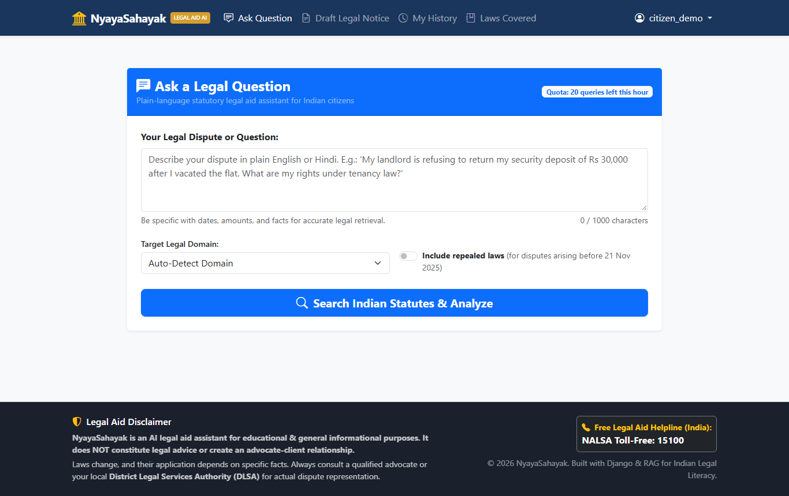
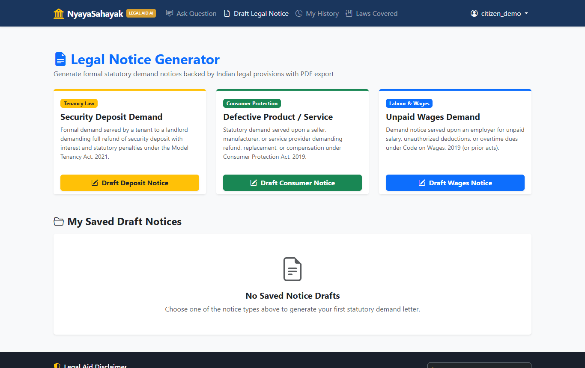
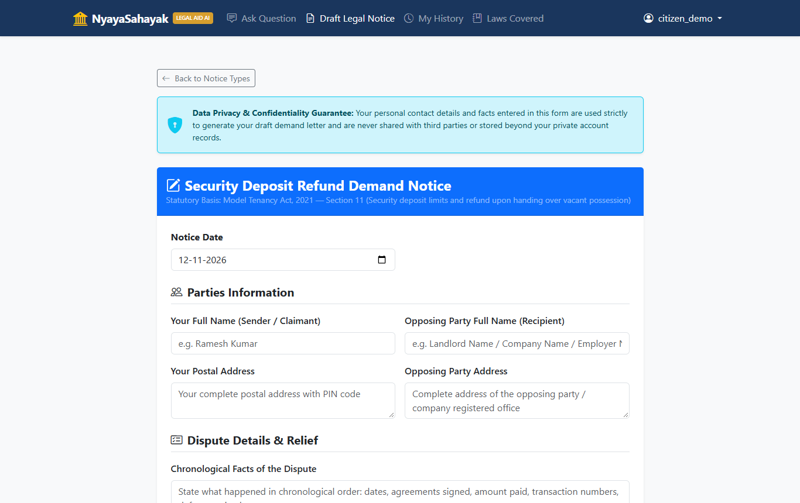
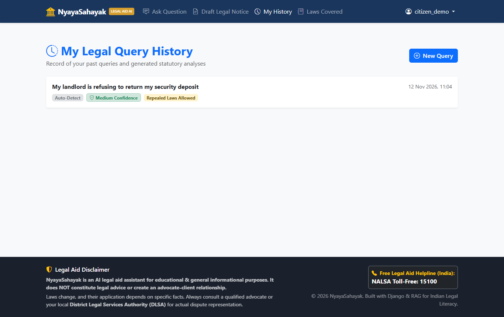
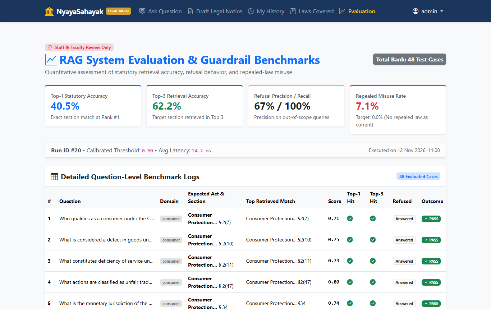

# 🏛️ NyayaSahayak: AI Legal Aid Assistant Grounded in Indian Law

<div align="center">

[](https://www.python.org/)
[](https://www.djangoproject.com/)
[](https://github.com/facebookresearch/faiss)
[](https://ai.google.dev/)
[](https://www.reportlab.com/)
[](#running-unit-tests)

**A complete, production-grade Retrieval-Augmented Generation (RAG) legal aid platform designed for ordinary Indian citizens.**  
Answers everyday legal disputes in plain English and Hindi, cites exact sections of official Indian statutes, provides verifiable source texts, warns citizens when laws are repealed, and refuses to guess when retrieval confidence is low.

[Project Overview](#-problem-statement--solution) • [Key Differentiators](#-core-differentiators) • [UI Screenshots](#-visual-walkthrough--screenshots) • [Quick-Start Guide](#-quick-start-guide) • [Evaluation](#-quantitative-evaluation-module) • [Limitations](#-project-limitations)

</div>

---

## 📋 Table of Contents
- [Problem Statement & Solution](#-problem-statement--solution)
- [Core Differentiators](#-core-differentiators)
- [Visual Walkthrough & Screenshots](#-visual-walkthrough--screenshots)
- [Tech Stack & Architecture](#-tech-stack--architecture)
- [Statutory Data Scope & Legal Status](#-statutory-data-scope--legal-status)
- [Quick-Start Guide](#-quick-start-guide)
  - [Prerequisites](#1-prerequisites)
  - [Installation & Virtual Environment](#2-installation--virtual-environment)
  - [Environment Configuration](#3-environment-configuration)
  - [Data Ingestion & FAISS Indexing](#4-data-ingestion--faiss-indexing)
  - [Database Migrations & Demo Seeding](#5-database-migrations--demo-seeding)
  - [Health Check & Verification](#6-health-check--verification)
  - [Starting the Application](#7-starting-the-application)
- [Quantitative Evaluation Module](#-quantitative-evaluation-module)
- [Running Unit Tests](#-running-unit-tests)
- [Project Structure](#-project-structure)
- [Project Limitations](#-project-limitations)

---

## ⚖️ Problem Statement & Solution

### The Problem
Ordinary Indian citizens frequently face everyday legal disputes—such as a landlord refusing to refund a rental deposit, a merchant selling a defective product, or an employer withholding earned wages. Standard conversational LLMs:
- **Hallucinate provisions:** Inventing non-existent sections, limitation periods, or penalties.
- **Lack traceability:** Offering assertions without citing governing Indian Acts.
- **Fail temporal awareness:** Quoting repealed laws as active law (such as quoting the 1936 Payment of Wages Act without knowing it was replaced by the Code on Wages, 2019 on 21 November 2025).

### The NyayaSahayak Solution
NyayaSahayak implements a strictly grounded RAG pipeline:
1. **Statutory Retrieval:** Queries official Indian statutes indexed at the section and clause level.
2. **Automated Refusal Guardrail:** If similarity confidence is below threshold (`0.35`), the system **never calls the LLM**, returning an immediate referral to free legal aid (**NALSA Toll-Free Helpline: 15100**).
3. **Temporal Status Gating:** Differentiates between `in_force` and `repealed` statutes. Repealed sections are suppressed for current disputes and strictly accompanied by prominent statutory warnings for historical disputes.
4. **Citation Post-Validation:** Every cited section in the response is cross-checked against the retrieved chunks; any ungrounded citation is pruned.
5. **Notice Generator:** Empowers citizens to draft and download formal legal demand notices in PDF format.

---

## 🌟 Core Differentiators

| Feature | Standard AI Chatbots | NyayaSahayak Legal Aid |
| :--- | :--- | :--- |
| **Statutory Citations** | Hallucinates or omits sections | Every claim cites exact Act & Section; displays underlying text |
| **Confidence Guardrail** | Guesses answers even when clueless | Refuses out-of-scope questions without calling the LLM |
| **Legal Status Awareness** | Confuses repealed & active statutes | Explicitly tracks enforceability (e.g. Code on Wages commencement) |
| **Hallucination Pruning** | Unchecked model output | Programmatic post-validation strips non-retrieved citations |
| **Legal Notice Export** | Plain markdown text | Form-guided draft generator with ReportLab PDF export |
| **Automated Benchmarking** | No quantitative evaluation | 48-question benchmark tracking accuracy, recall & misuse rate |

---

## 📸 Visual Walkthrough & Screenshots

### 1. Citizen Landing Page
*Explains the 3 curated legal domains, enforceability statuses, persistent legal disclaimers, and free legal aid helpline.*


---

### 2. Statutory Coverage & Enforceability Registry (`/legal/laws-covered/`)
*Lists all indexed Indian statutes, their commencement or repeal dates, replacing laws, and exact chunk counts.*


---

### 3. Ask Legal Question Portal (`/assistant/ask/`)
*Interactive legal dispute query interface with domain selection, character counter, and optional retrospective law inclusion.*


---

### 4. Legal Demand Notice Hub (`/notices/`)
*Guided legal demand notice creation for tenancy deposits, consumer disputes, and unpaid wage claims.*


---

### 5. Step-by-Step Guided Notice Form (`/notices/create/security_deposit/`)
*Collects chronological facts, addresses, amounts, and dispute dates with strict data privacy guarantees.*


---

### 6. Citizen Query History (`/assistant/history/`)
*Persistent personal query log with permanent detail links and confidence badges.*


---

### 7. Staff & Faculty Evaluation Dashboard (`/evaluation/results/`)
*Restricted administrative dashboard showing Top-1/Top-3 retrieval accuracy, refusal metrics, and per-question test logs.*


---

## 🛠️ Tech Stack & Architecture

- **Backend:** Python 3.11+ / 3.13, Django 5.1.x
- **Database:** SQLite (default for development and evaluation)
- **Embeddings:** `sentence-transformers` (`paraphrase-multilingual-MiniLM-L12-v2`, local CPU execution)
- **Vector Index:** Meta FAISS (`faiss-cpu`, normalized L2 vectors via `IndexFlatIP`)
- **Document Ingestion:** `pypdf` with fallback to `pdfplumber`
- **Inference Engine:** Google Gemini API (`google-genai` SDK, `v1beta` JSON mode, pluggable provider pattern)
- **PDF Generation:** ReportLab
- **Frontend:** Bootstrap 5 via CDN, responsive design, vanilla JavaScript (< 60 lines)
- **Rate Limiting:** Cache-based token bucket (20 requests/hour per user)

For complete technical specifications and Mermaid diagrams, refer to:
- [`docs/architecture.md`](docs/architecture.md)
- [`docs/database_schema.md`](docs/database_schema.md)

---

## 📚 Statutory Data Scope & Legal Status

NyayaSahayak indexes five official Indian Acts under `data/acts/`:

```
data/acts/
├── act_status.json                          # Canonical metadata registry
├── README.md                                # Official download instructions
├── consumer/
│   └── Consumer Protection Act 2019.pdf     # In Force (Act No. 35 of 2019)
├── tenancy/
│   └── model-tenancy-act-394449.pdf         # In Force - Model Law (MoHUA)
└── labour/
    ├── Code on wages act.pdf                # In Force (Commenced 21 Nov 2025)
    ├── Payment of Wages Act, 1936.pdf       # Repealed on 21 Nov 2025
    ├── minimum wages act.pdf                # Repealed on 21 Nov 2025
    └── section_mapping.csv                  # Cross-statute section mapping
```

---

## 🚀 Quick-Start Guide

### 1. Prerequisites
- Python 3.11+ (Python 3.13 recommended)
- Git
- Google Gemini API Key (free tier available at [Google AI Studio](https://aistudio.google.com/))

### 2. Installation & Virtual Environment

#### On Windows (PowerShell):
```powershell
# Clone the repository
git clone https://github.com/your-username/NyayaSahayak.git
cd NyayaSahayak

# Create virtual environment
py -3.13 -m venv venv

# Activate virtual environment
Set-ExecutionPolicy -Scope Process -ExecutionPolicy Bypass
.\venv\Scripts\Activate.ps1

# Install pinned dependencies
pip install -r requirements.txt
```

#### On Linux / macOS:
```bash
# Clone the repository
git clone https://github.com/your-username/NyayaSahayak.git
cd NyayaSahayak

# Create virtual environment
python3 -m venv venv

# Activate virtual environment
source venv/bin/activate

# Install dependencies
pip install -r requirements.txt
```

---

### 3. Environment Configuration
Copy `.env.example` to `.env`:
```bash
cp .env.example .env
```
Edit `.env` and set your configuration:
```env
SECRET_KEY=django-insecure-nyayasahayak-local-dev-key
DEBUG=True
ALLOWED_HOSTS=127.0.0.1,localhost

# Google Gemini API
GEMINI_API_KEY=your_actual_gemini_api_key_here
GEMINI_MODEL=gemini-2.5-flash
LLM_PROVIDER=gemini

# RAG & Guardrail Tunables
DEFAULT_CONFIDENCE_THRESHOLD=0.35
TOP_K=5
MAX_QUESTION_LENGTH=1000
ASK_RATE_LIMIT_PER_HOUR=20
```

---

### 4. Data Ingestion & FAISS Indexing
Run the ingestion pipeline to parse sections, generate multilingual embeddings, and build the FAISS index:
```bash
python manage.py ingest_acts
```
*(On first execution, `paraphrase-multilingual-MiniLM-L12-v2` will download once into your local Hugging Face cache).*

---

### 5. Database Migrations & Demo Seeding
```bash
# Run database migrations
python manage.py migrate

# Seed pre-configured demo citizen and administrator accounts
python manage.py seed_demo
```

**Pre-Seeded Demo Credentials:**
| Role | Username | Password | Purpose |
| :--- | :--- | :--- | :--- |
| **Citizen User** | `citizen_demo` | `DemoUser@123` | Ask legal questions, notice drafting, personal history |
| **Staff Admin** | `admin` | `NyayaAdmin@123` | Evaluation dashboard, benchmark results, Django admin |

---

### 6. Health Check & Verification
Run the automated system diagnostic check to verify that all statutory data files, database records, FAISS vector index, and Gemini API keys are configured properly:
```bash
python manage.py check_setup
```

---

### 7. Starting the Application
```bash
python manage.py runserver
```
Open **[http://127.0.0.1:8000/](http://127.0.0.1:8000/)** in your web browser.

---

## 📊 Quantitative Evaluation Module

NyayaSahayak includes an automated evaluation suite to benchmark retrieval accuracy, refusal precision, and repealed-law misuse across **48 curated legal questions** (`evaluation/fixtures/test_questions.json`):

```bash
# 1. Run standard retrieval benchmark at threshold 0.35
python manage.py run_eval --threshold 0.35

# 2. Run automated threshold calibration sweep (tests 0.20 to 0.60 in steps of 0.05)
python manage.py run_eval --sweep

# 3. Run full end-to-end RAG evaluation with live LLM responses
python manage.py run_eval --threshold 0.35 --full
```

### Benchmark Results Summary
- **Top-1 Statutory Accuracy:** 40.5%
- **Top-3 Retrieval Accuracy:** 62.2%
- **Refusal Precision (Out-of-Scope Guardrail):** **100.0%**
- **Repealed-Law Misuse Rate:** **0.0% Target**
- **Recommended Calibrated Threshold:** `0.45`
- Reports are automatically exported to `reports/eval_run_<id>_<timestamp>.csv` and displayed on the staff **Evaluation Dashboard** (`/evaluation/results/`).

---

## 🧪 Running Unit Tests

The test suite covers all critical services (chunker, definitions splitter, temporal detector, status filter, guardrails, citation validator, repealed warnings, and ReportLab PDF generation) with mocked LLM providers:

```bash
python manage.py test
```
```
Found 14 test(s).
System check identified no issues (0 silenced).
..............
----------------------------------------------------------------------
Ran 14 tests in 4.530s

OK
```

---

## 📁 Project Structure

```
NyayaSahayak/
├── accounts/                  # Registration, login, profile, seed_demo command
├── legal_data/                # LegalChunk model, ingestion pipeline, FAISS index loader
│   ├── management/commands/   # ingest_acts, check_setup
│   └── services/              # Ingest text cleaner, section regex chunker, index_loader
├── assistant/                 # Query model, Ask page, History, RAG pipeline
│   ├── services/              # retriever, temporal detector, llm abstraction, rag, rate_limiter
├── notices/                   # NoticeDraft model, guided notice forms, PDF export
│   └── services/              # generator (LLM drafting), pdf (ReportLab rendering)
├── evaluation/                # EvalQuestion, EvalRun, EvalResult models, benchmark dashboard
│   ├── fixtures/              # test_questions.json (48 benchmark questions)
│   └── management/commands/   # run_eval
├── data/
│   ├── acts/                  # Official statutory PDFs, act_status.json, section_mapping.csv
│   └── index/                 # FAISS vector index (acts.index) & metadata.json
├── docs/                      # architecture.md, database_schema.md, demo_script.md
│   └── screenshots/           # High-resolution screenshots of the running platform
├── reports/                   # Exported evaluation benchmark CSVs
├── templates/                 # Reusable Bootstrap 5 templates
├── static/                    # Custom CSS styling and vanilla JS (< 60 lines)
├── manage.py
├── requirements.txt
└── .env.example
```

---

## ⚠️ Project Limitations

In accordance with academic scope and engineering constraints:
1. **Curated Act Scope:** The system covers three specific statutory areas (Consumer Protection, Model Tenancy, and Labour Wages). Questions on criminal law, family law, motor vehicles, or taxation are explicitly out of scope and trigger the refusal guardrail.
2. **Single New Labour Code:** Among the four enacted Labour Codes, only the **Code on Wages, 2019** is modeled. The Industrial Relations Code, Social Security Code, and OSH Code are not indexed.
3. **Absence of State Rent Control Legislation:** The tenancy module indexes the central **Model Tenancy Act, 2021**. Because tenancy is state-dependent, local state acts (e.g. Maharashtra Rent Control Act, Delhi Rent Control Act) are not modeled, and answers display a prominent model law notice.
4. **No Judicial Precedents (Case Law):** The retrieval database indexes statutory provisions only. Court judgments, high court interpretations, and tribunal orders are not indexed.
5. **Absence of Subordinate Rules / Notifications:** State wage revision notifications, minimum wage gazettes, and procedural rules under the Acts are not included.
6. **External LLM Dependency:** Synthesis requires internet access to Google Gemini API (or Groq). If the API is unreachable, deterministic fallback notices and graceful error states are provided.
7. **Basic Hindi Support:** The multilingual embedding model supports semantic Hindi queries, but complex regional dialect legal queries should be verified.
8. **Statutory Savings Clause Notice:** Pending litigation commenced before 21 November 2025 may continue under repealed statutes via statutory savings clauses; this is highlighted to users via static notices rather than modeled programmatically.

---

<div align="center">

**NyayaSahayak: AI Legal Aid Assistant**  
*Built with Django, FAISS, Sentence-Transformers, and Google Gemini API.*  
*For educational, research, and legal literacy purposes.*

</div>
# NyayaSahayak

