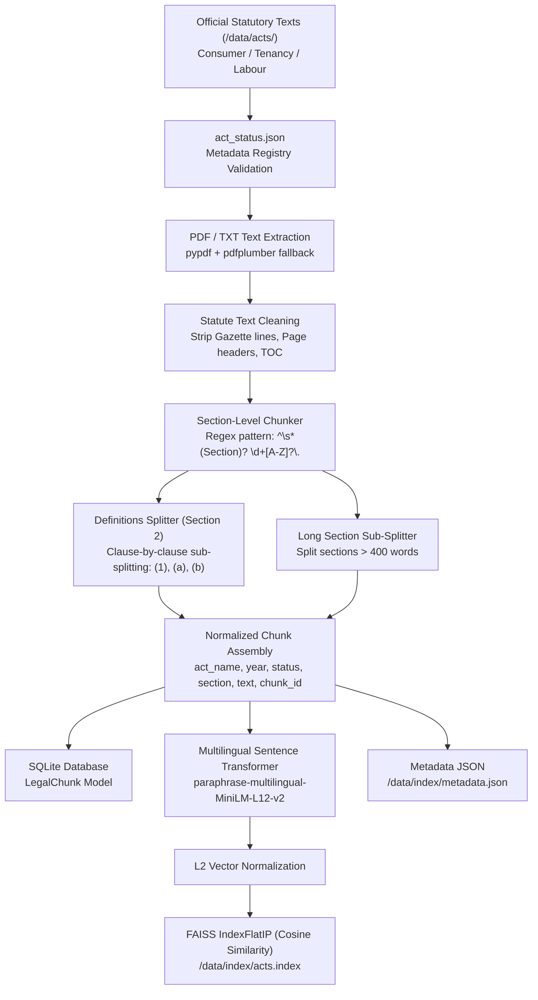
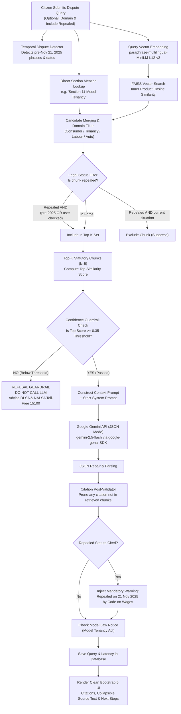
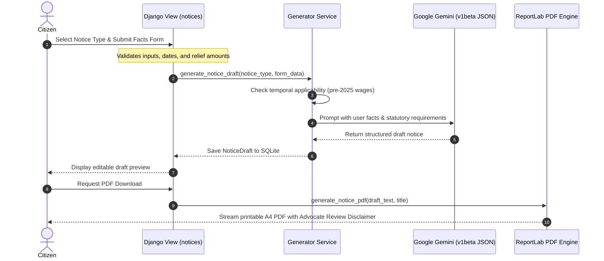

# NyayaSahayak System Architecture

**NyayaSahayak** is a specialized Retrieval-Augmented Generation (RAG) legal aid platform designed for ordinary Indian citizens. It enforces strict statutory grounding, temporal enforceability awareness (in force vs. repealed acts), confidence-based refusal guardrails, and deterministic post-validation to eliminate hallucinations.

---

## 1. Offline Ingestion Pipeline

The ingestion pipeline transforms raw statutory documents (`.pdf` or `.txt`) from `data/acts/` into section-level indexed chunks with complete enforceability metadata.

### Ingestion Stages
1. **Registry Verification:** Every file must match an entry in `act_status.json` with an explicit enforceability status (`in_force` or `repealed`), repealed date, and superseding law.
2. **Table of Contents Stripping:** Initial legislative arrangements of clauses are removed so that substantive statutory provisions are not shadowed by TOC entries.
3. **Clause-Level Definition Splitting:** Section 2 definitions (e.g. "consumer", "wages", "defect", "tenant") are sub-chunked by clause, enabling high-precision semantic lookup.
4. **Vector Embedding:** Chunks are embedded on CPU using `paraphrase-multilingual-MiniLM-L12-v2` and indexed via an inner product FAISS index (`IndexFlatIP`).

---

## 2. Online Citizen Query & RAG Workflow

The online flow handles plain-language legal queries in English or Hindi, enforces confidence guardrails, executes strict LLM inference, and validates citations.

---

## 3. Legal Notice Generation Flow

Citizens can generate formal demand letters based on structured dispute facts.

