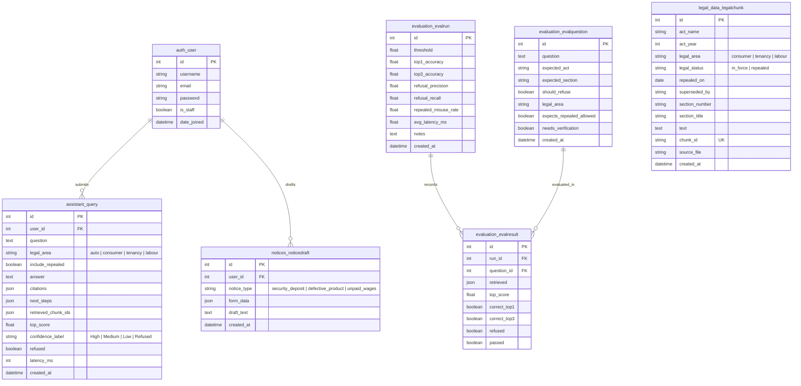

# NyayaSahayak Database Schema

The NyayaSahayak database is implemented in SQLite (default for development and evaluation) using Django ORM.

---

## Entity-Relationship (ER) Diagram

---

## Model Specifications & Indexes

### 1. `LegalChunk` (`legal_data`)
- **Indexes:**
  - `(legal_area, legal_status)` compound index for accelerated filtered vector search matching.
  - `(act_name, section_number)` compound index for direct section lookups.
  - `chunk_id` unique index.

### 2. `Query` (`assistant`)
- **Indexes:**
  - `created_at` index for historical sorting.
  - `refused` index for audit and evaluation queries.
  - Foreign key on `auth_user`.

### 3. `NoticeDraft` (`notices`)
- **Indexes:**
  - `created_at` descending index.
  - Foreign key on `auth_user`.

### 4. `EvalRun` and `EvalResult` (`evaluation`)
- Captures automated benchmark execution metrics (Top-1, Top-3, Refusal Precision/Recall, Repealed Misuse Rate, Latency).
- Linked through `run_id` and `question_id` foreign keys.

